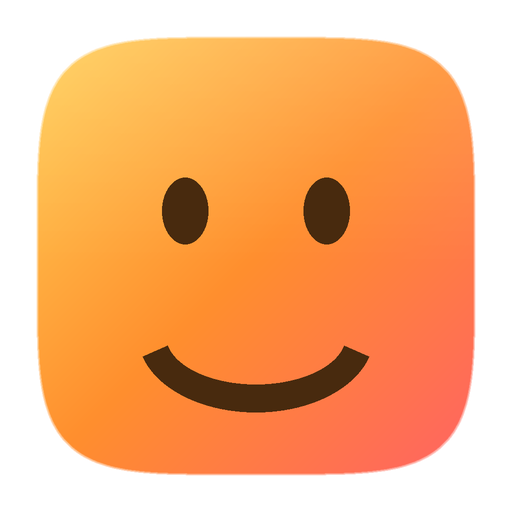
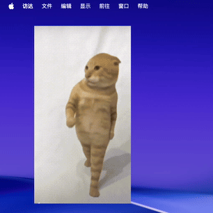

<div align="center">



# MemeDesk

**贴在桌面上的一层表情包，想放多久放多久。**

<!-- 徽章：一行平台与技术栈，一行发布与状态。两行之间不要留空行 —— 那会被拆成两个段落、行距明显偏大；用行尾的 <br> 换行，两行才同属一个段落。 -->

[](#环境要求)

<br>
[](https://github.com/sdtafxy/MemeDesk/releases/latest)
[](https://github.com/sdtafxy/MemeDesk/releases)
[](https://github.com/sdtafxy/MemeDesk/actions/workflows/ci.yml)
[](LICENSE)
[](https://github.com/sdtafxy/MemeDesk/stargazers)

**[English](README.en.md)** · [更新日志](CHANGELOG.md)



</div>

---

壁纸和截图都只能看，不会动。

MemeDesk 就干一件事：把你收的表情包钉在桌面上，一直循环播放。GIF、APNG、视频、图片都认，
放几个都行，能拖、能缩、能转、能弹，也能让它们跟着鼠标跑。它只待在菜单栏里 ——
不占 Dock，不改壁纸，不弹窗。

唯一会自己安静的时候，是你打开全屏视频。

## 能做什么

- 想放几个放几个，各自独立设置，下次开机还是这些
- GIF、APNG、PNG、JPG、HEIC、WebP、MP4、MOV、M4V，拖进来就行
- 三种图层：压在桌面图标下面、贴着桌面、浮在所有窗口上面
- 六种动作：静止、呼吸般浮动、撞墙弹跳、重力下落到屏幕底、跟着鼠标、自己乱逛
- 右键改大小、透明度、播放速度、旋转、镜像、鼠标穿透、锁定
- 拖到屏幕边缘会吸附，不会拖出屏幕找不回来
- 中英文双语，默认跟随系统
- 自带 6 个示例素材，素材库里点一下就出现在桌上

## 安装

去 [Releases](../../releases/latest) 下载 `MemeDesk-*.dmg`，打开，把 App 拖进「应用程序」。

> [!NOTE]
> 这个 App 没有 Apple 开发者签名，第一次打开会被 Gatekeeper 拦住。
> 在图标上右键选「打开」，之后就正常了。

发布包只有 Apple 芯片版本。Intel 机器得自己编译，见[自己编译](#自己编译)。

## 使用

点菜单栏那只脸，面板里有添加素材、素材库、设置，还有「全部收起」「暂停」「清空桌面」。

### 鼠标和键盘

- **拖动** —— 移动。拖到屏幕边上会吸附
- <kbd>⌥</kbd> + 拖动 —— 等比缩放
- **滚轮** —— 微调大小
- **双击** —— 只暂停这一个
- **右键** —— 大小、透明度、速度、旋转、图层、动作、镜像、穿透、锁定、复制、移除
- <kbd>⌘</kbd> <kbd>,</kbd> —— 打开设置

<details>
<summary>用 URL Scheme 控制（配 Raycast、Alfred、快捷指令）</summary>

```bash
open "memedesk://add?file=/Users/me/cat.gif"
open "memedesk://hide"    # 全部收起
open "memedesk://show"    # 全部显示
open "memedesk://pause"   # 全局暂停
open "memedesk://resume"  # 全局继续
open "memedesk://clear"   # 清空桌面
```

</details>

## 更新

设置里两个开关：自动检查更新（默认开），发现新版本后自动安装（默认关）。

自动安装会重启 App，所以默认没开。想省事就打开它；想自己看一眼再决定，就手动点「检查更新」。
有新版时，菜单栏面板的设置按钮上会亮一个小橙点。

装更新是原地替换 App 本身。桌面布局、素材路径、设置都在
`~/Library/Application Support/MemeDesk/`，位于 App 包外面，所以更新不会碰它们。

更新包先校验再装：SHA-256 必查。如果配了 Ed25519 公钥还会验签，
缺签名文件直接拒绝，不会退化成只查哈希。

检查更新是这个 App 唯一联网的地方，只请求 `api.github.com` 和 GitHub 的发布文件，不带任何标识。
关掉自动检查之后，就只有你亲手点按钮时才会发请求。

## 自己编译

需要完整的 Xcode。只有 Command Line Tools 不够 —— SwiftUI 的宏插件只随 Xcode 提供。

```bash
./Scripts/build.sh        # → dist/MemeDesk.app
open dist/MemeDesk.app
```

要 dmg 再跑 `./Scripts/make_dmg.sh`。想在 Xcode 里断点调试：

```bash
brew install xcodegen
xcodegen -s Xcode/project.yml
open MemeDesk.xcodeproj
```

## 关于那只脸

菜单栏图标不是 App 图标缩小版，是单独画的一套脸。

App 图标是个橙色圆角方块，塞进菜单栏会又重又小；而且菜单栏图标本来就该跟着系统明暗自动变色，
颜色不该由 App 说了算。所以它是模板图 —— 浅色菜单栏上是黑的，深色是白的。

图案有两组：8 个矢量画的（微笑、大笑、眨眼、惊讶、墨镜、爱心、难过、生气），
和 2 个从照片里抠出来的。设置里随时换，换完立刻生效。

## 常见问题

**第一次打开提示「无法验证开发者」？**
在 App 图标上右键选「打开」。没有开发者签名就是这样，文件没坏。

**Intel Mac 能用吗？**
能，但要自己编译。发布包只带 arm64。

**桌面上摆的东西存在哪？**
`~/Library/Application Support/MemeDesk/`。想彻底清空，删掉这个目录就行。

**会不会很吃 CPU？**
静止的时候基本是 0。会动的素材里，大 GIF 按窗口实际尺寸解码，不是按原图尺寸；
被窗口完全遮住、全屏、锁屏、用电池时都会自动暂停。

**桌面图标被挡住了？**
默认那层会压住桌面图标。右键把图层改成「在图标下面」可以夹在壁纸和图标之间，
但那一层的鼠标事件会被系统吞掉，改完就不能拖了。

## 环境要求

- macOS 13 Ventura 或更新
- Apple 芯片（Intel 请从源码编译）

## 许可证

[MIT](LICENSE)
